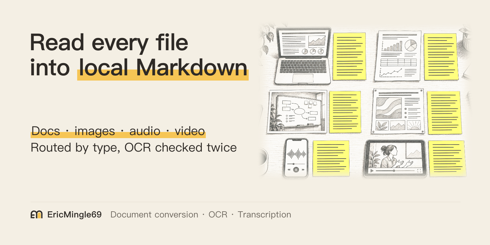

<picture>
  <source media="(prefers-color-scheme: dark)" srcset="readme-assets/cover-en-dark.png">
  
</picture>

<p align="center">
  <a href="references/architecture.md">Architecture</a> ·
  <a href="references/boundary-matrix.md">Format boundaries</a> ·
  <a href="SKILL.md">AI workflow</a> ·
  <a href="https://github.com/Ming-Sir-69">Author</a>
</p>

<p align="center">
  <a href="LICENSE"></a>
  
  
  
  
</p>

<p align="center">
  <a href="README.md">简体中文</a> · <b>English</b>
</p>

# Read Everything v3 · Type-based conversion to local Markdown files

This project converts Office files, structured documents, PDFs, images, audio and video into `<original filename>.md` beside the input. Extensions select the initial route; a local vision model then classifies PDFs and images. Text documents use Microsoft MarkItDown, visual content uses cloud OCR or description, and audio and video soundtracks use cloud or local speech transcription.

## Features

- **Document conversion**: MarkItDown handles Office files and EPUB, HTML, CSV, JSON, XML, IPYNB, ZIP and MSG; plain text is copied directly.
- **Four PDF routes**: The first page is classified as `TEXT`, `MIXED`, `ENGINEERING` or `OTHER`. Text PDFs are extracted directly, mixed PDFs combine the text layer with page OCR, and engineering drawings and scanned pages are rendered for recognition.
- **Four image routes**: Images are classified as `TEXT_IMAGE`, `POSTER`, `PHOTO` or `OTHER`. The first two receive OCR, photos receive a short description, and decorative images are skipped.
- **Multi-round visual recognition**: OCR makes two or three serial calls. Normalized text with similarity of at least 0.90 is accepted as consistent; if the third round still differs, the first and third results are retained with a warning.
- **Soundtrack transcription**: Audio uses DashScope ASR first and local whisper.cpp after failure. Video uses the same soundtrack path without visual analysis.
- **Uniform file output**: Results are written beside the input with route type, engine and rounds in a file header; an existing `.md` with the same name is overwritten.

## Quick start

From the repository root, install the Python dependencies:

```sh
python3 -m pip install "markitdown[all]" pypdfium2 pypdf dashscope openai requests Pillow
cp scripts/read_everything_config.example.json scripts/read_everything_config.json
python3 scripts/read_everything_v3.py document.docx --verbose
```

The output is `document.docx.md`. Configuration is required only for cloud OCR, photo description or cloud ASR; do not commit real credentials.

PDF and image classification uses the local Ollama model `qwen2.5vl:7b` by default:

```sh
ollama pull qwen2.5vl:7b
ollama serve
```

A container can also be built:

```sh
docker build -t read-everything-v3 .
docker run --rm \
  -v "$PWD:/data" \
  -v "$PWD/scripts/read_everything_config.json:/app/read_everything_config.json:ro" \
  read-everything-v3 /data/document.docx --verbose
```

The container includes Python 3.13 and ffmpeg, but not Ollama, whisper.cpp or model files.

## Usage

For individual files:

```sh
python3 scripts/read_everything_v3.py /path/to/file.pdf --verbose
python3 scripts/read_everything_v3.py /path/to/audio.m4a
```

As a Python module:

```sh
PYTHONPATH=scripts python3 - <<'PY'
from read_everything_v3 import read_everything

result = read_everything("document.docx", verbose=True)
print(result)
PY
```

The returned dictionary contains `ok`, `output`, `type`, `engine`, `rounds` and `verified`; failures contain `error`. These fields describe the selected route and file output, not proven content accuracy.

## Design

The main entry point is `scripts/read_everything_v3.py`. Processing follows “extension route → local PDF/image classification → selected backend → Markdown output”.

The first PDF page is rendered at 1.2× for Ollama classification; pages for OCR are rendered at 1.5×. Visual OCR uses Gemini 2.5 Flash first and NVIDIA NIM after failure. Results are normalized for case, whitespace and punctuation, then compared with `difflib.SequenceMatcher`; a third call includes a difference report when similarity is below 0.90.

If local classification is unavailable, PDFs fall back to `TEXT` and images to `TEXT_IMAGE`. The former does not switch to cloud OCR automatically, while the latter may still upload the image. Check networking, configuration and data boundaries before use.

## Limitations

- Dependencies are unpinned, and there is no automated test suite covering every route or public recognition-accuracy dataset. Agreement across rounds does not establish correctness; check important numbers and engineering dimensions against the original.
- The returned `verified` value is fixed to `true` after successful output, including results with cross-validation warnings. It does not replace human review.
- Paths for whisper.cpp, ffmpeg and the local model are hard-coded for macOS. Local audio/video fallback on other systems requires path changes.
- Inside the container, `localhost` refers to the container rather than the host Ollama service. Cloud routes upload input content; pricing, privacy and availability follow provider terms.
- Video processing transcribes only the soundtrack. Images classified as `OTHER` produce no output. Actual support for formats such as ZIP depends on MarkItDown and its optional dependencies.
- An existing `.md` with the same output name is overwritten, and the input directory must be writable.

## Development

Basic checks that need no external service:

```sh
python3 -m py_compile scripts/read_everything_v3.py
python3 scripts/read_everything_v3.py /path/to/plain-text.txt --verbose
```

`scripts/test_pdf_classification.py` depends on PDFs at machine-specific absolute paths and another Ollama classification model; it is not a standalone runnable test. Benchmark scripts are under `scripts/bench_*.py`, but the repository does not include all their inputs, result data or a unified reproduction entry point.

See the [Dockerfile](Dockerfile), [configuration template](scripts/read_everything_config.example.json) and [boundary matrix](references/boundary-matrix.md) for the container entry point, configuration mount and current format boundaries. Older architecture notes retain design-stage statements; the core script determines actual behavior.

## Acknowledgements

Cover illustrations were generated by an image generation model and processed by this project.

Document conversion uses Microsoft MarkItDown<sup>[[1]](#references)</sup>; PDF rendering and text handling use pypdfium2 and pypdf<sup>[[2]](#references)[[3]](#references)</sup>. Local classification uses Ollama<sup>[[4]](#references)</sup>, visual routes use Gemini and NVIDIA NIM<sup>[[5]](#references)[[6]](#references)</sup>, and cloud audio uses DashScope<sup>[[7]](#references)</sup>. Local transcription and soundtrack processing use whisper.cpp and FFmpeg<sup>[[8]](#references)[[9]](#references)</sup>.

## References

1. Microsoft. *MarkItDown: Python tool for converting files and office documents to Markdown*. <https://github.com/microsoft/markitdown>
2. pypdfium2 contributors. *pypdfium2 documentation: Rendering PDF pages*. <https://pypdfium2.readthedocs.io/en/stable/python_api.html#pypdfium2.PdfPage.render>
3. pypdf contributors. *pypdf documentation*. <https://pypdf.readthedocs.io/en/stable/>
4. Ollama. *Ollama API documentation: Generate a completion*. <https://github.com/ollama/ollama/blob/main/docs/api.md#generate-a-completion>
5. Google AI for Developers. *Gemini API: Image understanding*. <https://ai.google.dev/gemini-api/docs/image-understanding>
6. NVIDIA. *NVIDIA NIM API documentation*. <https://docs.api.nvidia.com/nim/reference>
7. Alibaba Cloud Model Studio. *Qwen ASR documentation*. <https://www.alibabacloud.com/help/en/model-studio/qwen-asr>
8. ggml-org. *whisper.cpp: Port of OpenAI's Whisper model in C/C++*. <https://github.com/ggml-org/whisper.cpp>
9. FFmpeg. *FFmpeg documentation*. <https://ffmpeg.org/documentation.html>

## Repository structure

| Path | Contents |
|---|---|
| `scripts/read_everything_v3.py` | Routing, conversion backends, cross-validation and CLI |
| `scripts/read_everything_config.example.json` | Cloud-service configuration template |
| `scripts/bench_*.py` | Vision-model and prompt benchmark scripts |
| `references/` | Architecture, format boundaries and migration notes |
| `SKILL.md` | AI workflow notes |
| `Dockerfile` | Python 3.13 and ffmpeg container environment |
| `readme-assets/` | Header and attribution assets |

---

Maintained by <picture><source media="(prefers-color-scheme: dark)" srcset="readme-assets/em-logo-dark.svg"></picture> <b>EricMingle69</b> · <a href="https://github.com/Ming-Sir-69">Ming-Sir-69</a><br>
Code and documentation are released under the [MIT License](LICENSE); third-party services and models retain their own licenses and terms.
