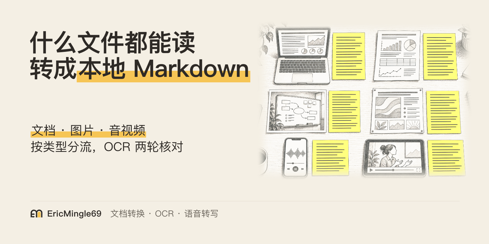

<picture>
  <source media="(prefers-color-scheme: dark)" srcset="readme-assets/cover-zh-dark.png">
  
</picture>

<p align="center">
  <a href="references/architecture.md">架构</a> ·
  <a href="references/boundary-matrix.md">格式边界</a> ·
  <a href="SKILL.md">AI 工作流</a> ·
  <a href="https://github.com/Ming-Sir-69">作者主页</a>
</p>

<p align="center">
  <a href="LICENSE"></a>
  
  
  
  
</p>

<p align="center">
  <b>简体中文</b> · <a href="README.en.md">English</a>
</p>

# Read Everything v3 · 按文件类型转换并保存 Markdown

本项目将 Office、结构化文档、PDF、图片、音频和视频转换为输入文件旁的 `<原文件名>.md`。扩展名负责初步分流；PDF 与图片再由本地视觉模型分类。文字文档使用 Microsoft MarkItDown，视觉内容使用云端 OCR 或描述，音频与视频音轨使用云端或本地语音转写。

## 主要功能

- **文档转换**：Office 与 EPUB、HTML、CSV、JSON、XML、IPYNB、ZIP、MSG 使用 MarkItDown；纯文本直接复制。
- **PDF 四路处理**：首页分为 `TEXT`、`MIXED`、`ENGINEERING`、`OTHER`。文字型直接提取，混合型合并文本层与页面 OCR，工程图与扫描页渲染后识别。
- **图片四路处理**：分为 `TEXT_IMAGE`、`POSTER`、`PHOTO`、`OTHER`；前两类 OCR，照片生成简短描述，装饰类图片跳过。
- **多轮视觉识别**：OCR 串行调用两至三轮。归一化文本相似度达到 0.90 即采用一致结果；第三轮仍不一致时保留首轮和第三轮，并写入警告。
- **音轨转写**：音频优先 DashScope ASR，失败后调用本地 whisper.cpp；视频复用同一音轨路径，不分析画面。
- **统一文件输出**：结果写在原文件旁，文件头记录路由类型、引擎和轮次；同名 `.md` 会被覆盖。

## 快速开始

在本仓库根目录准备 Python 依赖：

```sh
python3 -m pip install "markitdown[all]" pypdfium2 pypdf dashscope openai requests Pillow
cp scripts/read_everything_config.example.json scripts/read_everything_config.json
python3 scripts/read_everything_v3.py document.docx --verbose
```

输出为 `document.docx.md`。配置文件只在涉及云端 OCR、照片描述或云端 ASR 时需要填写；真实密钥不要提交。

PDF 与图片分类默认使用本机 Ollama 的 `qwen2.5vl:7b`：

```sh
ollama pull qwen2.5vl:7b
ollama serve
```

也可构建容器：

```sh
docker build -t read-everything-v3 .
docker run --rm \
  -v "$PWD:/data" \
  -v "$PWD/scripts/read_everything_config.json:/app/read_everything_config.json:ro" \
  read-everything-v3 /data/document.docx --verbose
```

容器包含 Python 3.13 与 ffmpeg，不包含 Ollama、whisper.cpp 或模型文件。

## 用法

单个文件：

```sh
python3 scripts/read_everything_v3.py /path/to/file.pdf --verbose
python3 scripts/read_everything_v3.py /path/to/audio.m4a
```

作为 Python 模块调用：

```sh
PYTHONPATH=scripts python3 - <<'PY'
from read_everything_v3 import read_everything

result = read_everything("document.docx", verbose=True)
print(result)
PY
```

返回字典包含 `ok`、`output`、`type`、`engine`、`rounds` 与 `verified`；失败时包含 `error`。这些字段描述本次路由和写出结果，不构成内容准确率证明。

## 设计与原理

核心入口是 `scripts/read_everything_v3.py`。处理顺序为“扩展名路由 → PDF/图片本地分类 → 对应后端 → 写出 Markdown”。

PDF 首页以 1.2 倍比例渲染后交给 Ollama 分类；OCR 页面以 1.5 倍比例渲染。视觉 OCR 优先 Gemini 2.5 Flash，失败时切换 NVIDIA NIM。两次结果经小写、空白和标点归一化后，以 `difflib.SequenceMatcher` 计算相似度；低于 0.90 时附加差异报告并进行第三轮。

本地分类不可用时，PDF 回退为 `TEXT`，图片回退为 `TEXT_IMAGE`。前者不会自动改用云 OCR，后者可能继续上传图片；使用前应确认网络、配置与数据边界。

## 局限

- 依赖未锁版，没有覆盖全部路由的自动化测试或公开识别准确率数据；多轮一致不等于内容正确，重要数字和工程尺寸仍需核对原件。
- 返回的 `verified` 在成功写出时固定为 `true`，包括带交叉验证警告的结果；它不能替代人工复核。
- whisper.cpp、ffmpeg 与本地模型路径按 macOS 写死。其他系统的本地音视频回退需要修改路径。
- 容器内的 `localhost` 指容器自身，默认不能访问宿主机 Ollama；云端分支会上传输入内容，费用、隐私和可用性依服务方条款。
- 视频只转写音轨；图片 `OTHER` 不生成输出。ZIP 等格式的实际支持范围取决于 MarkItDown 及其可选依赖。
- 原文件名相同的 `.md` 会被覆盖，输入目录必须可写。

## 开发

无需外部服务的基础检查：

```sh
python3 -m py_compile scripts/read_everything_v3.py
python3 scripts/read_everything_v3.py /path/to/plain-text.txt --verbose
```

`scripts/test_pdf_classification.py` 依赖本机绝对路径中的 PDF 和另一个 Ollama 分类模型，不是可直接运行的独立测试。基准脚本见 `scripts/bench_*.py`，仓库未附带其完整输入、结果数据或统一复现入口。

容器入口、配置挂载与现有格式边界分别见 [Dockerfile](Dockerfile)、[配置模板](scripts/read_everything_config.example.json) 和 [边界矩阵](references/boundary-matrix.md)。旧架构文档保留了设计阶段的表述，行为判断以核心脚本为准。

## 致谢

封面插画由图像生成模型生成，经本项目处理。

文档转换使用 Microsoft MarkItDown<sup>[[1]](#参考文献)</sup>；PDF 渲染与文本处理使用 pypdfium2 和 pypdf<sup>[[2]](#参考文献)[[3]](#参考文献)</sup>。本地分类使用 Ollama<sup>[[4]](#参考文献)</sup>，视觉分支使用 Gemini 与 NVIDIA NIM<sup>[[5]](#参考文献)[[6]](#参考文献)</sup>，云端音频使用 DashScope<sup>[[7]](#参考文献)</sup>。本地转写与音轨处理使用 whisper.cpp 和 FFmpeg<sup>[[8]](#参考文献)[[9]](#参考文献)</sup>。

## 参考文献

1. Microsoft. *MarkItDown: Python tool for converting files and office documents to Markdown*. <https://github.com/microsoft/markitdown>
2. pypdfium2 contributors. *pypdfium2 documentation: Rendering PDF pages*. <https://pypdfium2.readthedocs.io/en/stable/python_api.html#pypdfium2.PdfPage.render>
3. pypdf contributors. *pypdf documentation*. <https://pypdf.readthedocs.io/en/stable/>
4. Ollama. *Ollama API documentation: Generate a completion*. <https://github.com/ollama/ollama/blob/main/docs/api.md#generate-a-completion>
5. Google AI for Developers. *Gemini API: Image understanding*. <https://ai.google.dev/gemini-api/docs/image-understanding>
6. NVIDIA. *NVIDIA NIM API documentation*. <https://docs.api.nvidia.com/nim/reference>
7. Alibaba Cloud Model Studio. *Qwen ASR documentation*. <https://www.alibabacloud.com/help/en/model-studio/qwen-asr>
8. ggml-org. *whisper.cpp: Port of OpenAI's Whisper model in C/C++*. <https://github.com/ggml-org/whisper.cpp>
9. FFmpeg. *FFmpeg documentation*. <https://ffmpeg.org/documentation.html>

## 仓库结构

| 位置 | 内容 |
|---|---|
| `scripts/read_everything_v3.py` | 路由、转换后端、交叉验证与 CLI |
| `scripts/read_everything_config.example.json` | 云服务配置模板 |
| `scripts/bench_*.py` | 视觉模型与提示词基准脚本 |
| `references/` | 架构、格式边界与迁移记录 |
| `SKILL.md` | AI 工作流说明 |
| `Dockerfile` | Python 3.13 与 ffmpeg 容器环境 |
| `readme-assets/` | 页眉与署名资源 |

---

文档维护：<picture><source media="(prefers-color-scheme: dark)" srcset="readme-assets/em-logo-dark.svg"></picture> <b>EricMingle69</b> · <a href="https://github.com/Ming-Sir-69">Ming-Sir-69</a><br>
代码与文档以 [MIT 许可](LICENSE) 发布；第三方服务与模型沿用各自许可及服务条款。
